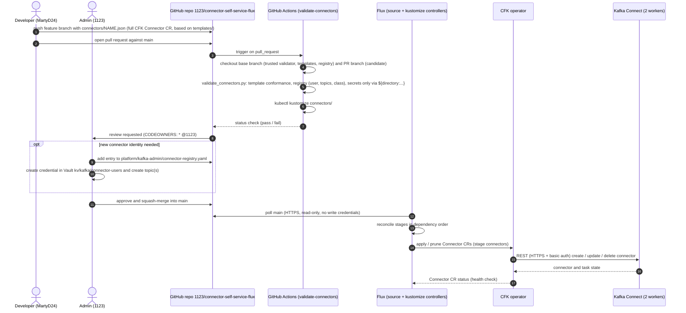
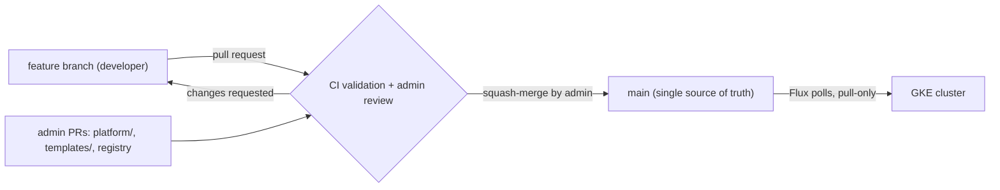
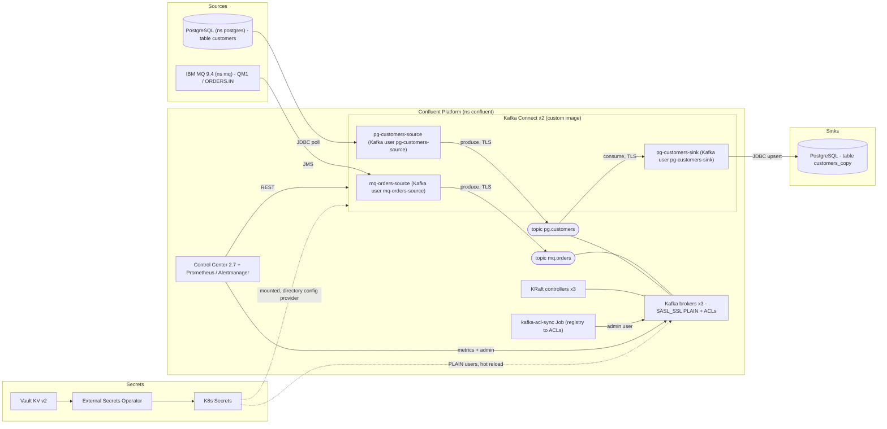
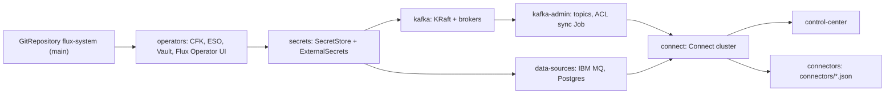

# Architecture and workflow

Self-service Kafka connectors on Confluent Platform (CFK on GKE), delivered via GitOps with Flux.

## 1. Self-service workflow (PR to running connector)

## 2. Git branches

## 3. Runtime components and data flow

## 4. Flux stages (Kustomizations in `clusters/poc/platform.yaml`)

## 5. Responsibilities

| Actor / component | Owns |
|---|---|
| Developer | `connectors/*.json` via pull requests |
| Admin | PR review and squash-merge, `templates/`, `platform/`, connector registry, Vault credentials, topics |
| GitHub Actions | Validation of the PR against the trusted templates/registry from the base branch |
| Flux | Pull-only sync of `main`, ordered stages, prune on delete |
| CFK | Kafka, KRaft, Connect, Control Center, Connector CRs |
| Vault + ESO | All credentials; one Kafka user per connector |
| ACL sync Job | Reconciles ACLs from the registry (least privilege per connector) |

## UI access (via port-forward)

| UI | URL | Credentials |
|---|---|---|
| Vault | https://localhost:8200 | root token in `.secrets/vault-init.json` |
| Flux UI | http://localhost:9080 | anonymous, read-only |
| Control Center | https://localhost:9021 | `c3-admin` / `c3-viewer` from Vault `kv/kafka/control-center` |
